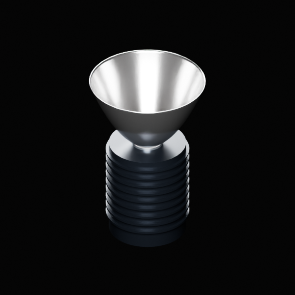
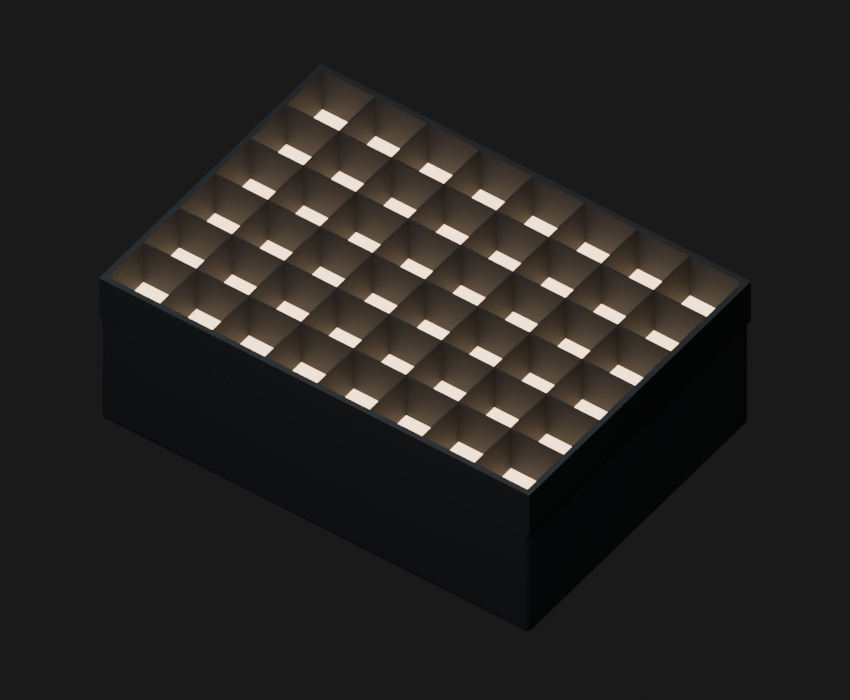
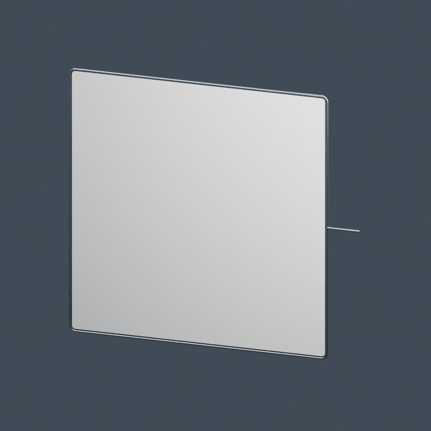
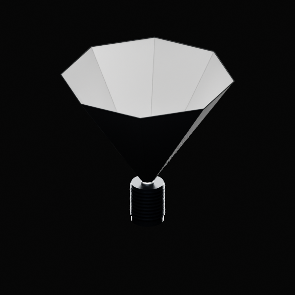
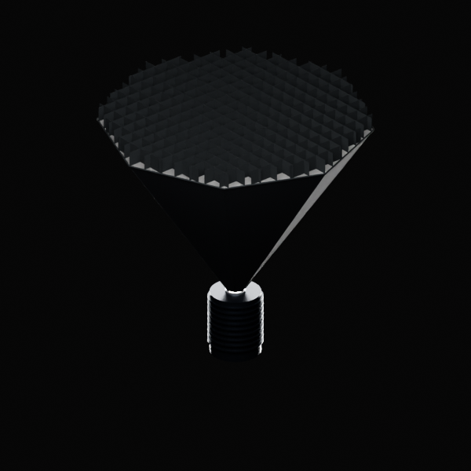
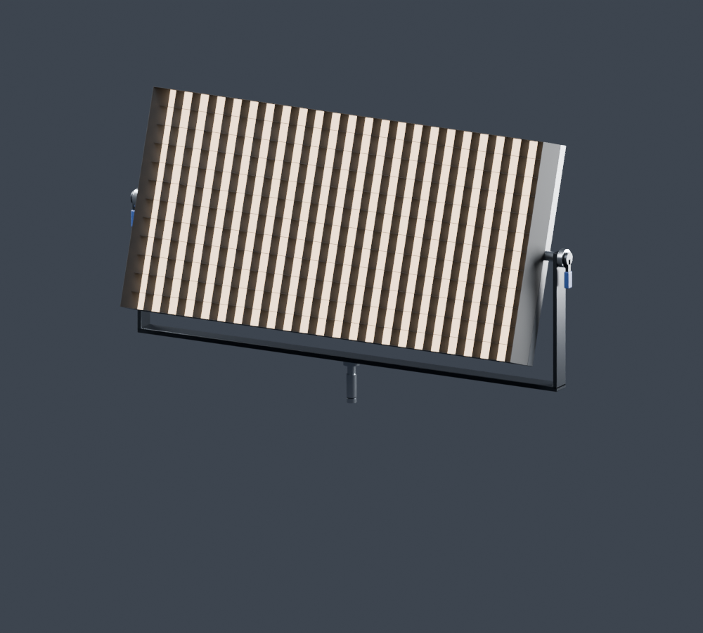

# Procedural Lighting

Procedural Blender lighting assets by **Sympatico**: a configurable
COB light with native illumination in Bare, Reflector, Fresnel, and Octobox modes, a native-Area
panel light, a diffusion frame with ten fabric presets, and procedural
C-Stand and Combo Stand grip equipment, including a mounted fabric assembly. Built and
validated in **Blender 5.2.2 LTS**.

| COB Light | Panel Light (Softbox) | Diffusion Frame |
| --- | --- | --- |
|  |  |  |

| Octobox | Octobox Grid | Yoke |
| --- | --- | --- |
|  |  |  |

## Install

1. In Blender, open **Preferences → File Paths → Asset Libraries**.
2. Press **+** and choose this repository's `library/` folder. Name it
   **Sympatico Lighting**. Set its import method to **Append (Reuse Data)**.
3. Switch an editor to the **Asset Browser**, select **Sympatico Lighting**,
   and drag an asset into the viewport. Select the fixture body and open
   **Modifiers** to adjust its controls. Use **Cycles** and Rendered viewport
   shading to see illumination.

Alternative: **File → Append → `library/Sympatico_Lighting_Native.blend`**,
then choose a Collection (COB Light, Panel Light, C-Stand + Fabric) or Object
(Diffusion Frame, C-Stand, Combo Stand). Stands and the mounted fabric assembly
appear under **Sympatico → Grip** in the Asset Browser.

Native-light fixtures contain multiple objects (a control mesh plus a Spot or
Area light). To copy a complete fixture, use **Duplicate Collection** in the
Outliner, or drag the asset in again; duplicating only the control mesh will
not duplicate its light. Likewise, duplicate the entire **C-Stand + Fabric**
collection to keep the stand, fabric, and boom mount together.

## Assets

### COB Light

Collection asset `COB Light — Native Fresnel`. Select **COB Light** for all
controls.

- Wattage, Temperature (K), RGB, and an RGB/Kelvin mix.
- COB diameter in inches; resizing changes source size while preserving power.
- Attachment: Bare, Reflector, Fresnel, or Octobox. Every mode uses a native
  Blender light; the visible COB disk is camera-only and adds no illumination.
- Bare uses a disk Area light sized to the COB diameter.
- Reflector uses a Spot light with spread derived from reflector diameter and depth.
- Fresnel uses a native Blender Spot light (not mesh emission), with an
  independent source-radius control for shadow softness, plus a 15–45 degree
  simulated beam angle.
- Octobox size, depth, and Full / Half / Quarter Silk fabric, with an
  optional square-cell grid and perimeter wrapper.
- Octobox uses a disk Area source at the front fabric plane, sized to fit inside
  the octagonal opening. Fabric selection scales power by the existing fitted
  direct-plus-scattered transmission coefficients. This approximates the softbox
  output; it does not trace the internal reflector and diffusion transport.

### Panel Light

Collection asset `Panel Light — Native Area`. Select **Panel Light** for
controls.

- Width, height, and body depth in feet.
- Wattage, Temperature (K), RGB, and RGB/Kelvin mix, driving a native
  rectangular Area light at the panel's front face.
- Optional front rim and egg-crate grid with independent edge/grid depths.
- Yoke toggle and tilt.

### Diffusion Frame

Object asset `Diffusion Frame`.

- Width and height set the fabric size in inches.
- Frame type: 3/8" round, 1" square, nominal 1-1/4" speed rail, or none.
- Ten fabrics: Solid, Silk, Half Silk, Quarter Silk, Ultrabounce, 215 Half
  Tough Spun, 250 Half White Diffusion, Opal Frost, Unbleached Muslin, and
  Bleached Muslin. Eight of these are fitted to published manufacturer
  reference data — see
  [`research/diffusion_calibration_2026-10-07/`](research/diffusion_calibration_2026-10-07/).
- Optional pin (side rod), Show Frame, and a separate Fabric toggle.
- **Mount at Pin** places the mounting pin center at the object origin for
  attachment to a grip head.

### C-Stand

Object asset `C-Stand`, under **Sympatico → Grip**.

- Stand Height and independent Riser 1 / Riser 2 extension controls in inches.
- Optional grip head and 40-inch boom arm.
- Arm elevation, swivel, slide, and end-grip rotation controls.
- **Bag It** adds a saddle sandbag over the tallest leg.

### Combo Stand

Object asset `Combo Stand`, under **Sympatico → Grip**.

- **Stand Height (in)** sets the junior receiver height; the upper riser
  extends first, followed by the middle and lower risers.
- **Bag It** toggles the sandbag.

### C-Stand + Fabric

Collection asset `C-Stand + Fabric`, under **Sympatico → Grip**.

- Includes **Mounted C-Stand**, **Mounted Fabric**, and **Boom Mount**.
- Select **Mounted C-Stand** for stand, boom, and Flag Tilt X / Y controls.
- Select **Mounted Fabric** for frame dimensions, fabric preset, frame type,
  and pin-mount controls, using the same options as the standalone Diffusion Frame.
- Import or duplicate the complete collection to keep the assembly together.

## Updating existing COB fixtures

Re-import the complete COB collection from the updated library, or run
[`scripts/upgrade_cob_native.py`](scripts/upgrade_cob_native.py) in Blender to
upgrade existing fixtures in the open file. The script changes the rig in memory;
review the result and save your scene afterward. Keep the repository intact,
since the script reads the fabric coefficients under `research/`.

Bare, Reflector, and Octobox brightness and distribution change with this upgrade.
Recheck exposure and lighting balance in existing scenes; Fresnel retains its
previous power mapping. Existing collection and Fresnel-object names are retained
for compatibility.

## Working with copies

Append (Reuse Data) intentionally shares underlying node groups and
materials: editing a node tree or material affects every copy using that
data. Make data single-user before customizing its structure independently.

Rotate the object to aim it. Use modifier dimensions rather than object scale
for predictable physical sizing.

## Project layout

- [`library/`](library/): the current asset library (`Sympatico_Lighting_Native.blend`
  and its `blender_assets.cats.txt` catalog). Add this folder, not the `.blend`
  file, as the Asset Library path.
- [`docs/images/`](docs/images/): preview renders used in this README.
- [`scripts/`](scripts/): the native COB upgrade and a headless Cycles regression
  test (`blender -b library/Sympatico_Lighting_Native.blend --python scripts/verify_cob_native.py`).
- [`research/`](research/): diffusion fabric reference data, measurements, and
  the calibration scripts used to fit the fabric presets above.

## Accuracy

These are artistic lighting fixtures, not certified photometric models.
Wattage is an artistic Blender power control, not calibrated electrical
consumption or manufacturer lumens. Fresnel uses a directional
emitting-lens simulation, not refractive glass optics. Diffusion fabric
behavior is fitted to published reference data but is not an exact
reproduction of any single manufacturer's measured product.

## A note on AI

We used AI tools during development to help build and manage the geometry
node trees behind each fixture. Those networks get large and intricate
quickly, and AI made it practical to keep them organized and working. The
design, the on-set knowledge behind how each light and fabric should behave,
and the testing are ours.

## License

The Blender assets (`library/`, `docs/images/`) are licensed under
**CC BY 4.0** — see [LICENSE-ASSETS.txt](LICENSE-ASSETS.txt) and
[ATTRIBUTION.txt](ATTRIBUTION.txt).

The research and build scripts (`research/`, `scripts/`) are licensed under
**GPL-3.0-or-later** — see [LICENSE](LICENSE).

Third-party reference materials used to calibrate the diffusion fabrics
retain their respective owners' rights; see
[ATTRIBUTION.txt](ATTRIBUTION.txt) and
[`research/diffusion_calibration_2026-10-07/sources.json`](research/diffusion_calibration_2026-10-07/sources.json).
