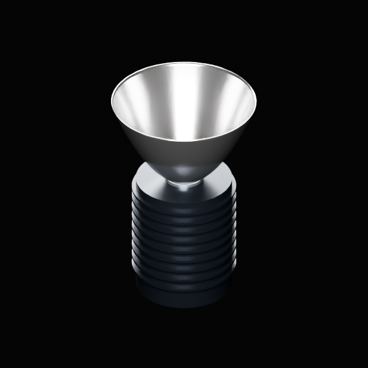
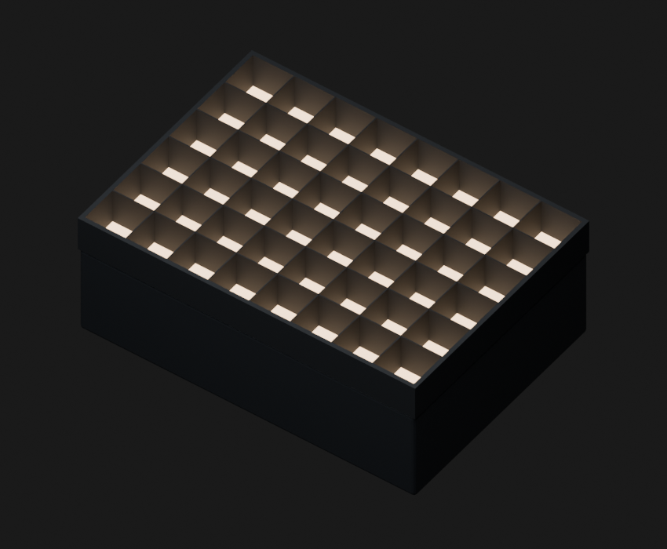
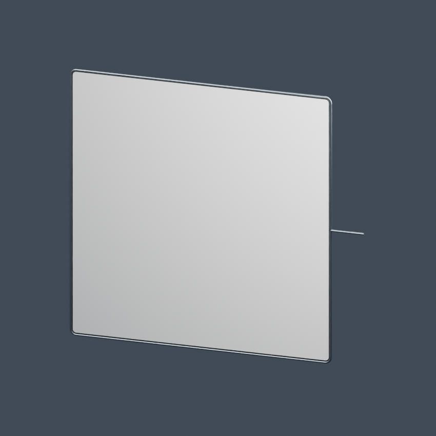
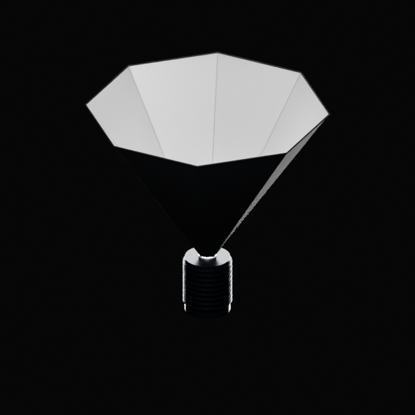
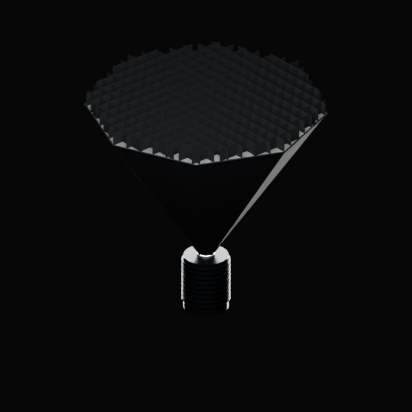
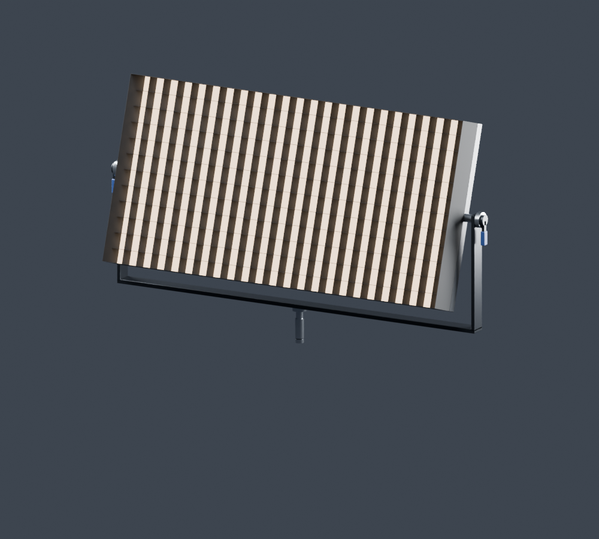

# Procedural Lighting

Procedural Blender lighting assets by **Sympatico Media, LLC**: a configurable
COB light with native Fresnel, reflector and octobox attachments, a native-Area
panel light, and a diffusion frame with ten fabric presets. Built and
validated in **Blender 5.2.2 LTS**.

| COB Light | Panel Light (Softbox) | Diffusion Frame |
| --- | --- | --- |
|  |  |  |

| Octobox | Octobox Grid | Yoke |
| --- | --- | --- |
|  |  |  |

## Install

1. In Blender, open **Preferences → File Paths → Asset Libraries**.
2. Press **+** and choose this repository's `library/` folder. Name it
   **Sympatico Lighting**. Set its import method to **Append (Reuse Data)**.
3. Switch an editor to the **Asset Browser**, select **Sympatico Lighting**,
   and drag an asset into the viewport. Select the fixture body and open
   **Modifiers** to adjust its controls. Use **Cycles** and Rendered viewport
   shading to see illumination.

Alternative: **File → Append → `library/Sympatico_Lighting_Native.blend`**,
then choose a Collection (COB Light, Panel Light) or Object (Diffusion Frame).

Native-light fixtures contain multiple objects (a control mesh plus a Spot or
Area light). To copy a complete fixture, use **Duplicate Collection** in the
Outliner, or drag the asset in again; duplicating only the control mesh will
not duplicate its light.

## Assets

### COB Light

Collection asset `COB Light — Native Fresnel`. Select **COB Light** for all
controls.

- Wattage, Temperature (K), RGB, and an RGB/Kelvin mix.
- COB diameter in inches; resizing preserves the area-normalized power.
- Attachment: Bare, Reflector, Fresnel, or Octobox.
- Fresnel uses a native Blender Spot light (not mesh emission), with an
  independent source-radius control for shadow softness, plus a 15–45 degree
  simulated beam angle.
- Octobox size, depth, and Full / Half / Quarter Silk fabric, with an
  optional square-cell grid and perimeter wrapper.

### Panel Light

Collection asset `Panel Light — Native Area`. Select **Panel Light** for
controls.

- Width, height, and body depth in feet.
- Wattage, Temperature (K), RGB, and RGB/Kelvin mix, driving a native
  rectangular Area light at the panel's front face.
- Optional front rim and egg-crate grid with independent edge/grid depths.
- Yoke toggle and tilt.

### Diffusion Frame

Object asset `Diffusion Frame`.

- Width and height set the fabric size in inches.
- Frame type: 3/8" round, 1" square, nominal 1-1/4" speed rail, or none.
- Ten fabrics: Solid, Silk, Half Silk, Quarter Silk, Ultrabounce, 215 Half
  Tough Spun, 250 Half White Diffusion, Opal Frost, Unbleached Muslin, and
  Bleached Muslin. Eight of these are fitted to published manufacturer
  reference data — see
  [`research/diffusion_calibration_2026-10-07/`](research/diffusion_calibration_2026-10-07/).
- Optional pin (side rod) and a Show Frame / Fabric toggle.

## Working with copies

Append (Reuse Data) intentionally shares underlying node groups and
materials: editing a node tree or material affects every copy using that
data. Make data single-user before customizing its structure independently.

Rotate the object to aim it. Use modifier dimensions rather than object scale
for predictable physical sizing.

## Project layout

- [`library/`](library/): the current asset library (`Sympatico_Lighting_Native.blend`
  and its `blender_assets.cats.txt` catalog). Add this folder, not the `.blend`
  file, as the Asset Library path.
- [`docs/images/`](docs/images/): preview renders used in this README.
- [`research/`](research/): diffusion fabric reference data, measurements, and
  the calibration scripts used to fit the fabric presets above.

## Accuracy

These are artistic lighting fixtures, not certified photometric models.
Wattage is an area-normalized Blender emission control, not calibrated
electrical consumption or manufacturer lumens. Fresnel uses a directional
emitting-lens simulation, not refractive glass optics. Diffusion fabric
behavior is fitted to published reference data but is not an exact
reproduction of any single manufacturer's measured product.

## License

The Blender assets (`library/`, `docs/images/`) are licensed under
**CC BY 4.0** — see [LICENSE-ASSETS.txt](LICENSE-ASSETS.txt) and
[ATTRIBUTION.txt](ATTRIBUTION.txt).

The research and build scripts (`research/`) are licensed under
**GPL-3.0-or-later** — see [LICENSE](LICENSE).

Third-party reference materials used to calibrate the diffusion fabrics
retain their respective owners' rights; see
[ATTRIBUTION.txt](ATTRIBUTION.txt) and
[`research/diffusion_calibration_2026-10-07/sources.json`](research/diffusion_calibration_2026-10-07/sources.json).
